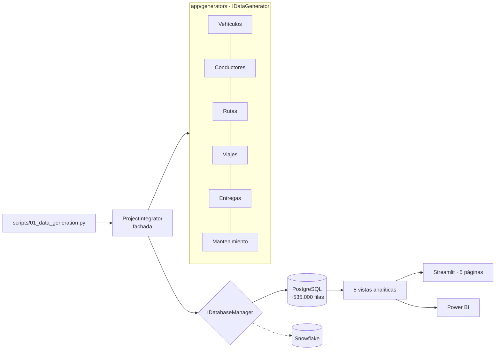

<p align="center"></p>

<h1 align="center">FleetLogix</h1>

<p align="center"><b>Synthetic data generation and logistics modeling to analyze fleet, routes and deliveries.</b></p>

<p align="center"></p>

<p align="center">
      
</p>

<p align="center"><a href="https://dodysalim.github.io/"><b>🌐 Portfolio</b></a> · <a href="README.md"><b>🇪🇸 Versión en español</b></a></p>

---

## 📌 At a glance

| | |
| --- | --- |
| **🎯 Problem** | Turn related logistics entities into service and performance indicators. |
| **🛠️ Solution** | SOLID generation pipeline (injectable generators and database), relational schema and 8 analytical views. |
| **📈 Deliverables** | ~535,000 synthetic rows, 5-page Streamlit dashboard and Power BI export. |
| **🧪 Quality** | 8 automated tests; verified end-to-end on PostgreSQL 16. |

## 🏗️ Architecture



## 🚀 How to run

```bash
pip install -r requirements.txt -r dashboard_streamlit/requirements.txt
bash dashboard/setup/setup.sh        # PostgreSQL + data + views
python -m streamlit run dashboard_streamlit/streamlit_app.py
python -m pytest tests -q
```

## ⚖️ Scope

Synthetic data; AWS integrations described in the project were not verified as production services.

---

<p align="center">
<b>Dody Dueñas Remache</b> · Data Analyst / Data Scientist · Guayaquil, Ecuador (remote LATAM)<br>
<a href="https://dodysalim.github.io/">Portfolio</a> · <a href="https://github.com/dodysalim">GitHub</a> · <a href="https://www.linkedin.com/in/dody-duenas/">LinkedIn</a> · <a href="mailto:dodydurema67@gmail.com">dodydurema67@gmail.com</a>
</p>
